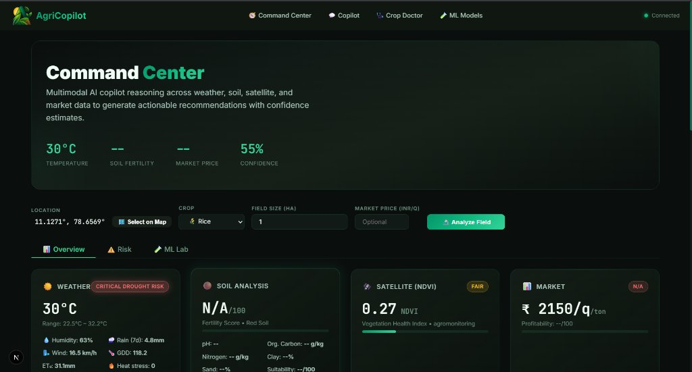
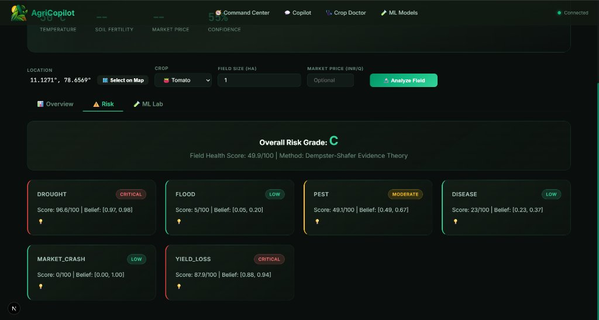
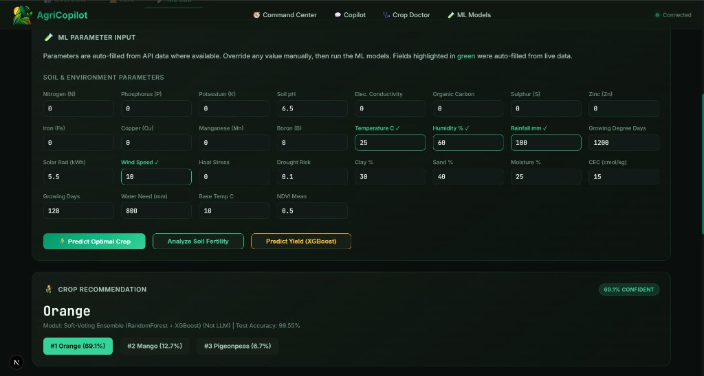
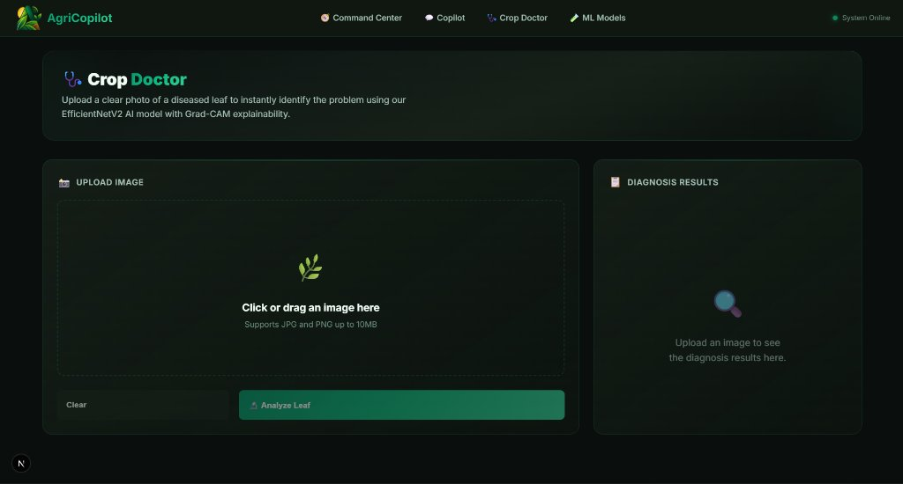
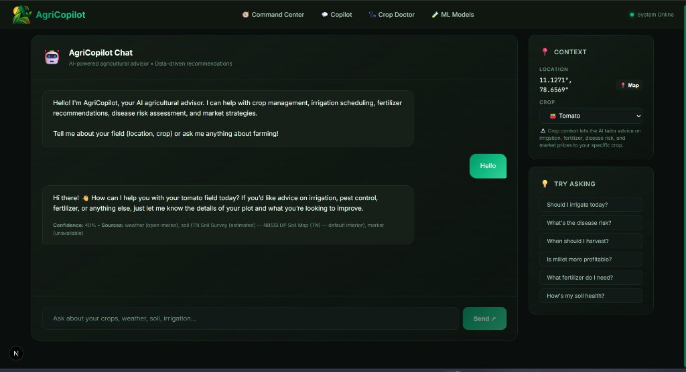

# 🌾 AgriCopilot: Multimodal Precision-Agriculture Decision Support System

[](https://nextjs.org/)
[](https://fastapi.tiangolo.com/)
[](https://pytorch.org/)
[](https://huggingface.co/abishektamilarasan)
[](https://xgboost.readthedocs.io/)
[](LICENSE)

**AgriCopilot** is an explainable, multimodal precision-agriculture platform that unifies 9 heterogeneous agricultural feeds (weather, soil grids, Sentinel-2 NDVI, mandi prices, crop calendars) across 4 AI model families. It integrates **Dempster–Shafer Evidence Theory** for sensor-dropout risk fusion and **Retrieval-Augmented Generation (RAG)** grounded in ICAR/TNAU agricultural advisory manuals.

---

## 📸 Platform Interface & Dashboards

### 1. Command Center & Telemetry Overview
*Real-time agronomic telemetry showing Open-Meteo weather forecasts, ISRIC SoilGrids 2.0 chemical profiles, Sentinel-2 NDVI canopy vigor, and live Agmarknet mandi commodity pricing.*



---

### 2. Multimodal Risk Assessment (Dempster–Shafer Fusion)
*Six-dimensional risk analysis (Drought, Flood, Pest, Disease, Market Crash, Yield Loss) computing explicit Belief–Plausibility intervals and epistemic uncertainty $m(\Theta)$ when sensors or satellite feeds drop out.*



---

### 3. ML Parameter Input & Crop Recommendation
*Agronomic parameter override lab featuring the **Soft-Voting Ensemble (Random Forest + XGBoost)** predicting optimal crop choices with confidence distributions across 22 crops (99.55% accuracy).*



---

### 4. Crop Doctor (Dual-Cascade Vision Classifier)
*Fine-grained leaf pathology diagnosis powered by cascading **EfficientNetV2-S** models with **Grad-CAM** saliency heatmaps to localize lesion hotspots on leaves.*



---

### 5. Grounded Copilot Chat (RAG)
*Multi-turn conversational assistant grounded in curated TNAU/ICAR extension handbooks via ChromaDB vector retrieval, dynamically aware of the field's real-time soil, weather, and crop context.*



---

## 🚀 Key Architectural Highlights

- **🔬 Dual-Cascade Crop Doctor (EfficientNetV2-S):**
  - **Model 1A (Indian Field Conditions):** 17 classes across Rice, Wheat, Corn, Potato, and Sugarcane (**94.82% Accuracy**, 0.945 Macro-F1).
  - **Model 1B (PlantVillage Lab Benchmark):** 38 pathology classes (**99.49% Accuracy**).
  - Dynamic cascading: if Model 1A confidence $\ge 0.60$, diagnosis is accepted; otherwise cascades to Model 1B.
- **🌱 Crop Recommendation Engine:**
  - Soft-Voting Ensemble (Random Forest + XGBoost) across 22 crops (**99.55% Test Accuracy**).
- **🧪 Soil Fertility Health Classifier:**
  - Agronomic Super-Ensemble (ExtraTrees + Random Forest + XGBoost) grading N-P-K and micronutrient health (**95.84% 5-Fold Cross-Validation Accuracy**).
- **📈 Dual-Tier Yield Regression:**
  - **Tier A (District-Level):** Trained on 246,000+ empirical records from the Ministry of Agriculture & Farmers Welfare, India ($R^2 = 0.8411$).
  - **Tier B (Field-Level):** Micro-agronomic regression explained via **TreeSHAP** and calibrated with **Split Conformal Prediction Intervals** ($\pm 6.33\text{ t/ha}$ at 90% confidence).
- **🛡️ Multimodal Risk Fusion (Dempster–Shafer Theory):**
  - Sensor-dropout resilience: Missing API feeds or cloud-occluded satellite tiles ($>50\%$) allocate weight to ignorance $m(\Theta)$ rather than using fabricated defaults.
- **💬 Grounded Agricultural Copilot (RAG):**
  - ChromaDB vector store querying official TNAU/ICAR guides with real-time field state injection.

---

## 📁 Repository Structure

```text
├── docs/
│   └── assets/               # Dashboard screenshots and UI preview images
├── frontend/                 # Next.js 16 UI (Tailwind CSS, Leaflet maps, Chart.js)
│   ├── app/                  # Application pages (Command Center, Doctor, ML Lab, Chat)
│   └── components/           # Reusable UI cards and visualization components
├── backend/                  # FastAPI microservices & REST endpoints
│   ├── api/                  # REST routers (/copilot, /vision, /ml, /weather)
│   ├── data_sources/         # Handlers for Open-Meteo, SoilGrids, Sentinel-2, Agmarknet
│   └── rag/                  # ChromaDB vector store and TNAU agronomy documents
├── AgriCopilot_IEEE_Report.pdf # Full research paper & benchmark report
└── README.md                 # Project documentation and quickstart
```

---

## ⚡ Quickstart

### Prerequisites
- Python 3.10+
- Node.js 18+ and npm

### 1. Backend Setup
```bash
cd backend
python -m venv venv

# Windows
venv\Scripts\activate
# Linux/macOS
source venv/bin/activate

pip install -r requirements.txt
python -m uvicorn main:app --reload --port 8000
```
Interactive API Swagger documentation is available at `http://localhost:8000/docs`.

### 2. Frontend Setup
```bash
cd frontend
npm install
npm run dev
```
Open `http://localhost:3000` to launch the AgriCopilot dashboard.

---

## 📄 Research Paper
For complete technical details, benchmarks, and mathematical proofs, refer to:
- [`AgriCopilot_IEEE_Report.pdf`](AgriCopilot_IEEE_Report.pdf)

---

## 📜 License
Distributed under the MIT License. See `LICENSE` for more information.
